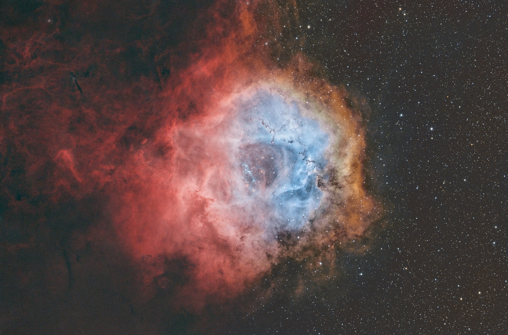
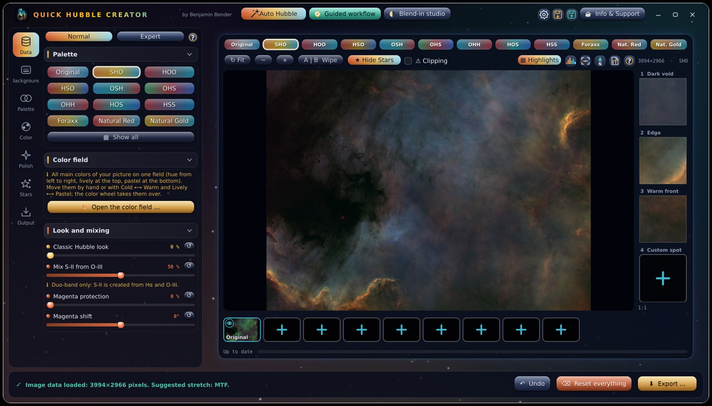
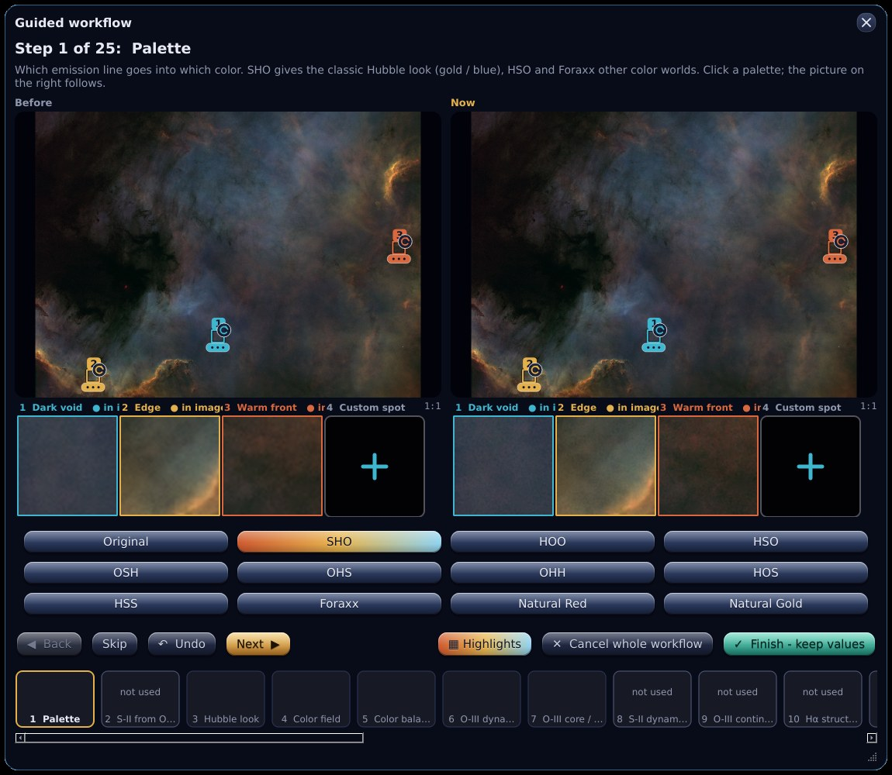
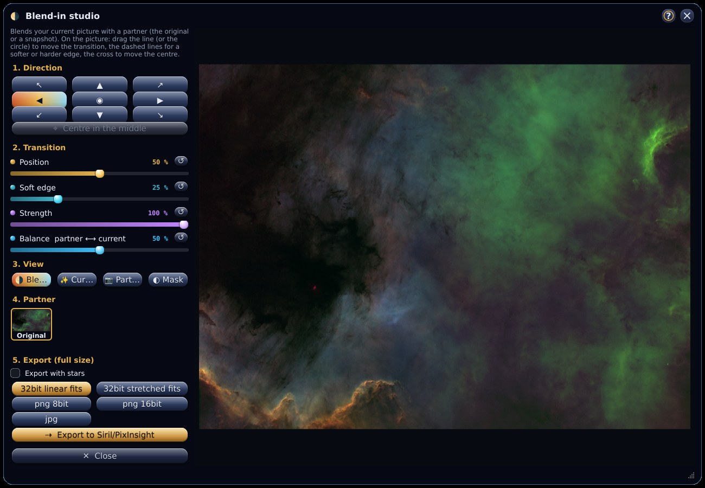

# Quick Hubble Creator (QHC)

**From narrowband raw data to the Hubble look in a few steps - a Windows program for astrophotographers.**

[Deutsche Version](README.md) · [Download (Releases)](../../releases) · [Support on Ko-fi](https://ko-fi.com/skorpid) · Contact: starlog.developer@gmail.com

*Example: Rosette Nebula processed with QHC.*

---

## What is QHC for?

QHC is made for everyone who shoots with duo-band filters (for example smart telescopes or cameras with dual-band filters) or with real narrowband filters (Ha, O-III, S-II) and wants to turn the data into pictures with the **false-colour palettes of the Hubble Space Telescope** (SHO, HOO, HSO, Foraxx and others) - without working through dozens of tools in several programs.

You load your data, QHC checks and prepares it, suggests a palette and leads you step by step to the finished picture. Every step shows **Before and Now** side by side, and every change can be undone.

## The interface

*Main window: menus on the left (Data, Background, Palette, Color, Fine-tuning, Stars, Output), preview with palette bar, highlight crops and snapshot bar.*

*Guided workflow: step by step with Before / Now, tips and an Undo button.*

*Blend-in studio: blend the current picture with the original or a snapshot and export it.*

## What can QHC do?

**Data and preparation**
- Import of **duo-band**, **dual duo-band** and **single files** (Ha / O-III / S-II) in FITS format
- Input check: linear or stretched? Stars, noise, gradient, sky coordinates
- **Guided preparation**: remove gradient, sharpen, denoise, remove stars (starless) and treat the stars separately - with a warning when nebula structure might be lost
- **Smart crop** also cuts away empty borders where only some of the files have data
- Plate solving / sky coordinate overlay

**Look and colour**
- Palettes SHO, HOO, HSO, OSH, OHS, OHH, HOS, HSS, **Foraxx**, Natural Red / Gold and a Hubble-look slider
- **Auto Hubble**: automatically searches the palette, channel mix and colour preset that come closest to the typical Hubble look and shows twelve variants to choose from, you can also set your favorite colors
- **Colour wheel / colour field** with zones, magenta protection, saturation, brightness and reference picture
- Mix S-II from O-III, channel separation, darken and desaturate the background

**Fine-tuning**
- Colour boost, local contrast, colour-noise smoothing, edge protection
- **Stars** adjustable separately (brightness, saturation)
- **Clipping and burn-out warning** at every slider; highlights are held softly instead of being cut off

**Output**
- **Guided workflow** through all steps, an expert mode for all sliders
- **Snapshots**, **highlights** (detail crops for checking) and A/B comparison
- **Blend-in studio**: blend two states (for example original and result) into each other along a direction or in a circle
- Export: **32-bit linear FITS** (for further work in Siril / PixInsight), 32-bit stretched FITS, PNG 8/16-bit, JPG
- Interface in **German and English**

## Advantages over the usual way of working

| Usual way | With QHC |
|---|---|
| Several programs one after another (Siril, PixInsight, Photoshop ...), each with its own handling | One program, one fixed route from raw data to export |
| Palette, channel mix and hue by hand and feeling | Auto Hubble suggests variants; colour wheel and colour field for fine adjustment |
| You see only at the end whether a step made the picture worse | Before / Now in every step, undo, snapshots |
| Burnt-out highlights and colour islands show up late | Clipping warning at every slider, soft highlights |
| Stars and nebula are stretched together | Stars separate, with their own brightness and saturation |
| A lot of learning needed | Normal mode for beginners, expert mode for all sliders |

## System requirements

- **Windows 10 or 11, 64 bit**
- **Memory:** at least 8 GB, 16 GB recommended.
- **Screen:** 1600 x 900 pixels or more recommended
- **Graphics card:** none special, the calculation runs on the processor
- **Input data:** FITS files (linear, taken with a duo-band, narrowband or smart telescope)
- **Optional:** installed programs such as BlurXTerminator, NoiseXTerminator, StarXTerminator, StarNet or GraXpert are used when available; an internet connection is needed for sky coordinates (plate solving). Siril is not required but recommended.

## Installation

1. Download `QHC.exe` from [Releases](../../releases)
2. Start it - no installation needed
3. At the first start choose the language and, if you like, the external programs in the settings

> Windows sometimes shows a SmartScreen warning for new programs. "More info -> Run anyway" starts QHC.

## About the code

No protected program code of others was copied. QHC works with generally known and widely used rules and formulas of image processing (for example the midtone transfer function, ArcSinh stretch, colour-space maths, wavelets and standard noise statistics), which were modified and extended for this program.

## License

QHC is **not open source**. All rights belong to Benjamin Bender. `QHC.exe` may be used free of charge for your own, non-commercial use. Copying, modifying, redistributing or commercially using the code or the program is not allowed without my permission. Details: [LICENSE.txt](LICENSE.txt). Open-source components used: [THIRD_PARTY_NOTICES.md](THIRD_PARTY_NOTICES.md). Pictures you create with QHC belong to you.

## Support and contact

This project holds countless evenings and weekends that I invested at my own expense. If QHC helps you with your pictures, I would be glad about your support - for this and my other projects:

Feedback, ideas and bug reports: **starlog.developer@gmail.com** or as an [issue](../../issues) here on GitHub.

*Quick Hubble Creator - by Benjamin Bender*
