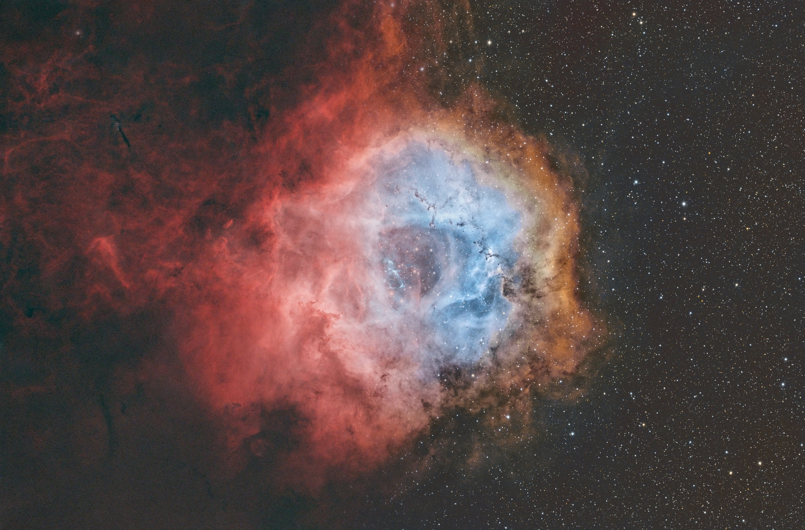
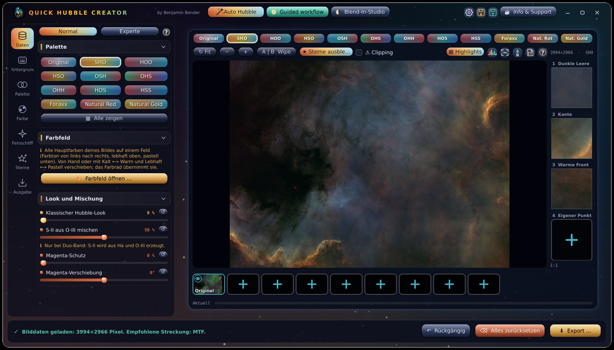
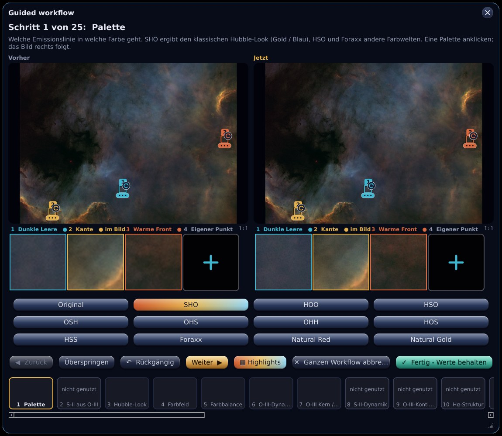
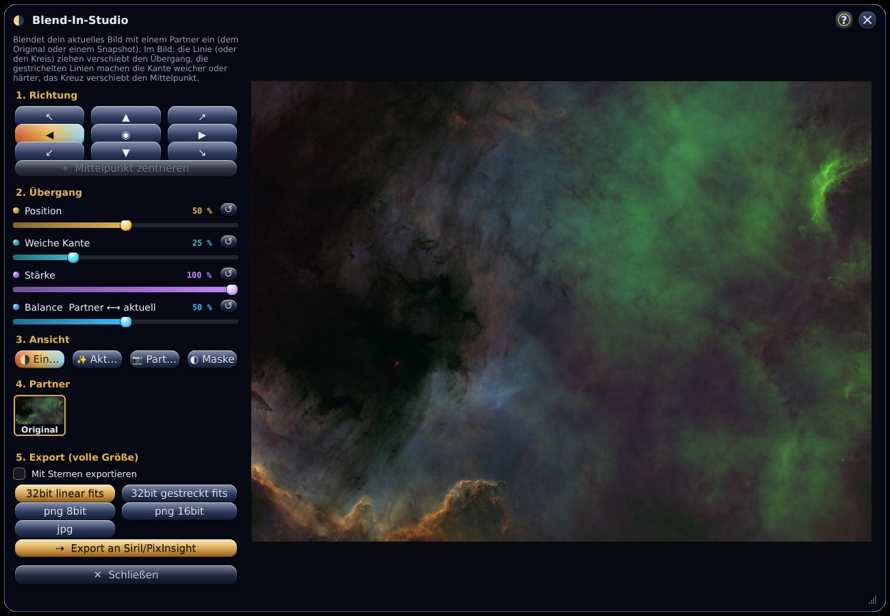
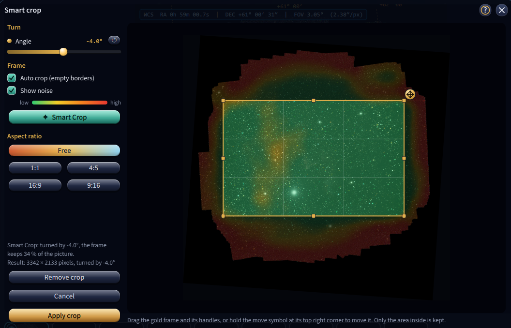

# Quick Hubble Creator (QHC)

**Aus Schmalband-Rohdaten in wenigen Schritten zum Hubble-Look – Windows-Programm für Astrofotografen.**

[English version](README.en.md) · [Download (Releases)](../../releases) · [Support auf Ko-fi](https://ko-fi.com/skorpid) · Kontakt: starlog.developer@gmail.com

*Beispiel: Rosettennebel, bearbeitet mit QHC.*

---

## Wofür ist QHC gedacht?

QHC ist für alle, die mit Duo-Band-Filtern (z. B. Smart-Teleskope oder Kameras mit L-eXtreme-artigen Filtern) oder mit echten Schmalbandfiltern (Hα, O-III, S-II) fotografieren und daraus Bilder mit den **Falschfarben-Paletten des Hubble-Teleskops** (SHO, HOO, HSO, Foraxx u. a.) machen wollen – ohne sich durch dutzende Werkzeuge in mehreren Programmen zu arbeiten.

Du lädst deine Daten, QHC prüft sie, bereitet sie vor, schlägt eine Palette vor und führt dich Schritt für Schritt zum fertigen Bild. Jeder Schritt zeigt **Vorher und Jetzt** nebeneinander, jede Änderung lässt sich rückgängig machen.

## Die Oberfläche

*Die Menübersicht mit Histogram, einem Fits header Vergleich und Highlightausschnitten und vorher nachher Wippen.*

*Hauptfenster: Menüs links (Daten · Hintergrund · Palette · Farbe · Feinschliff · Sterne · Ausgabe), Vorschau mit Palettenleiste, Highlight-Ausschnitten und Snapshot-Leiste.*

*Guided workflow: Schritt für Schritt mit Vorher/Jetzt, Tipps und Rückgängig-Knopf.*

*Blend-in-Studio: das aktuelle Bild mit dem Original oder einem Snapshot einblenden und exportieren.*

*Smart Crop: Auf einen Blick die Stellen mit schlechtem Signal erkennen und abschneiden.*

## Was kann QHC?

**Daten & Vorbereitung**
- Import von **Duo-Band-**, **Dual-Duo-Band-** und **Single-Files** (Hα / O-III / S-II) im FITS-Format
- Eingangsprüfung: linear oder gestreckt? Sterne, Rauschen, Gradient, Himmelskoordinaten
- **Guided preparation**: Gradient entfernen, Schärfen, Entrauschen, Sterne entfernen (Starless) und Sterne separat behandeln – mit Warnung, wenn Nebelstruktur verloren gehen könnte
- **Smart Crop** schneidet leere Ränder auch dort ab, wo nur ein Teil der Dateien Daten hat
- Plate Solving / Himmelskoordinaten-Overlay

**Look & Farbe**
- Paletten SHO, HOO, HSO, OSH, OHS, OHH, HOS, HSS, **Foraxx**, Natural Red / Gold und ein Hubble-Look-Regler
- **Auto Hubble**: sucht automatisch Palette, Kanalmischung und Farbvoreinstellung, die dem typischen Hubble-Look am nächsten kommen und zeigt zwölf Varianten zur Auswahl, mit der Möglichkeit die Lieblingskombination zu speichern.
- **Farbrad / Farbfeld** mit Zonen, Magenta-Schutz, Sättigung, Helligkeit und Referenzbild
- S-II aus O-III mischen, Kanaltrennung, Hintergrund abdunkeln und entsättigen

**Feinschliff**
- Farbe anheben, lokaler Kontrast, Farbrauschen glätten, Kantenschutz
- **Sterne** getrennt regelbar (Helligkeit, Sättigung)
- **Clipping- und Burn-out-Warnung** an jedem Regler; Lichter werden weich gehalten statt hart abgeschnitten

**Ausgabe**
- **Guided workflow** durch alle Schritte, ein Experte-Modus für alle Regler
- **Snapshots**, **Highlights** (Detailausschnitte zur Kontrolle) und A/B-Vergleich
- **Blend-in-Studio**: zwei Bearbeitungsstände (z. B. Original und Ergebnis) in einer Richtung oder im Kreis ineinander überblenden
- Export: **32-bit FITS linear** (zum Weiterarbeiten in Siril / PixInsight), 32-bit FITS gestreckt, PNG 8/16-bit, JPG
- Oberfläche auf **Deutsch und Englisch**

## Vorteile gegenüber der bisherigen Arbeitsweise

| Bisher | Mit QHC |
|---|---|
| Mehrere Programme nacheinander (Siril, PixInsight, Photoshop …), jedes mit eigener Bedienung | Ein Programm, ein fester Ablauf von den Rohdaten bis zum Export |
| Palette, Kanalmischung und Farbton per Hand und Gefühl | Auto Hubble schlägt Varianten vor; Farbrad und Farbfeld für die Feinabstimmung |
| Man sieht erst am Ende, ob ein Schritt das Bild verschlechtert hat | Vorher/Jetzt in jedem Schritt, Rückgängig, Snapshots |
| Ausgebrannte Lichter und Farbinseln fallen spät auf | Clipping-Warnung an jedem Regler, weiche Lichter |
| Sterne und Nebel werden gemeinsam gestreckt | Sterne getrennt, mit eigener Helligkeit und Sättigung |
| Viel Einarbeitung nötig | Normal-Modus für Einsteiger, Experte-Modus für alle Regler |

## Systemvoraussetzungen

- **Windows 10 oder 11, 64 Bit**
- **Arbeitsspeicher:** mindestens 8 GB, empfohlen 16 GB.
- **Bildschirm:** ab 1600 × 900 Pixel empfohlen
- **Grafikkarte:** keine besondere nötig, die Berechnung läuft auf dem Prozessor
- **Eingangsdaten:** FITS-Dateien (linear, aufgenommen mit Duo-Band-, Schmalband- oder Smart-Teleskop)
- **Optional:** vorhandene Programme wie BlurXTerminator, NoiseXTerminator, StarXTerminator, StarNet oder GraXpert werden bei Bedarf angesprochen; für die Himmelskoordinaten (Plate Solving) wird eine Internetverbindung gebraucht. Siril ist nicht nötig aber empfehlenswert.

## Installation

1. Unter [Releases](../../releases) die Datei `QHC.exe` herunterladen
2. Starten – eine Installation ist nicht nötig
3. Beim ersten Start in den Einstellungen die Sprache und gegebenenfalls die externen Programme wählen

> Windows zeigt bei neuen Programmen manchmal eine SmartScreen-Warnung. Mit „Weitere Informationen → Trotzdem ausführen“ startet QHC.

## Zum Code

Es wurde kein geschützter Programmcode anderer kopiert. QHC arbeitet mit allgemein bekannten und weit verbreiteten Regeln und Formeln der Bildbearbeitung (zum Beispiel Midtone-Transfer-Funktion, ArcSinh-Stretch, Farbraum-Rechnungen, Wavelets und übliche Rauschstatistik), die für dieses Programm abgewandelt und erweitert wurden.

## Lizenz

QHC ist **kein Open Source**. Alle Rechte liegen bei Benjamin Bender. Die Datei `QHC.exe` darf kostenlos für den eigenen, nicht kommerziellen Gebrauch genutzt werden. Den Code und das Programm zu kopieren, zu verändern, weiterzugeben oder kommerziell zu nutzen ist ohne meine Erlaubnis nicht gestattet. Details: [LICENSE.txt](LICENSE.txt). Verwendete Open-Source-Komponenten: [THIRD_PARTY_NOTICES.md](THIRD_PARTY_NOTICES.md). Deine mit QHC erstellten Bilder gehören dir.

## Support & Kontakt

Dieses Projekt steckt voller Abende und Wochenenden, die ich auf eigene Kosten investiert habe. Wenn dir QHC bei deinen Bildern hilft, freue ich mich über Unterstützung – für dieses und meine weiteren Projekte:

Rückmeldungen, Ideen und Fehlermeldungen: **starlog.developer@gmail.com** oder als [Issue](../../issues) hier auf GitHub.

*Quick Hubble Creator – von Benjamin Bender*
